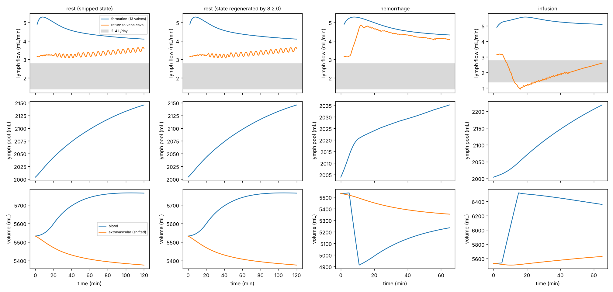

# P5: lymph in BioGears 8.2.0

**Date:** 2026-11-02. BioGears `8.2.0+0-c5227b6`, Linux x86_64, pybiogears at this commit. StandardMale@0s, 30-s samples.

**Result: lymph exists, is readable and behaves consistently, but it has three properties that `viva-biogears` must handle:**
1. The shipped state is not at fluid steady state.
2. Lymph return is a passive resistor that is very sensitive to venous pressure.
3. Resting flow sits a little above the 2–4 L/day band.

## How lymph is modelled (source: `BioGears.cpp`, `BioGears::SetupTissue`)

- Each of 13 tissues has extracellular nodes E1–E3 and two pre-lymphatic nodes L1 → L2. L2 drains through a one-way valve path `<Tissue>ToLymphValve` into a single `Lymph` node.
- The `Lymph` node is a 2.0 L compliance at 5 mmHg. It empties through the resistor `LymphToVenaCava` into the vena cava.
- The design target in the source is `lymphTotalBody_mL_Per_min = 3.5` ("~5 L/day"), split among tissues by extracellular water.
- A `Lymph` liquid compartment maps the `Lymph` node, but **no compartment links are created for lymph**: all the `LymphLink` definitions are commented out. So the compartment's `InFlow`/`OutFlow` are invalid (NaN), and **no standard data request reads lymph flow**.

## What this probe added to pybiogears

- **Circuit requests.** `FluidPath` (Flow, FlowSource, PressureSource, Resistance, Compliance) and `FluidNode` (Pressure, Volume) read elements of the active cardiovascular circuit by name, through the public `BioGears::GetCircuits()`. Lymph flow is `FluidPath/Flow/LymphToVenaCava`; formation is the sum of the 13 `<Tissue>ToLymphValve` flows.
- **Bug fix: requested units were ignored after the first sample.** BioGears' engine auto-tracks its data requests by default. Every sample it re-runs `PhysiologyEngineTrack::SetupRequests`, which re-connects each request in the engine's native unit and leaks a scalar each time. The thunk now calls `SetAutoTrackFlag(false)`, because it reads values itself.
  - P2 was unaffected, because its units happened to be the defaults; it still matches the CLI to 3.8e-13.
  - Regression test: `test_requested_units_are_honoured`. A mutant with auto-tracking left on fails it, plus two other tests.
- **Bug fix: an invalid unit threw a C++ exception out of `set_requests`.** BioGears throws, rather than returning null, for an unknown unit. The request is now reported as unconnected and the error is logged (`test_invalid_unit_is_unconnected`).

## Method

- `p5_lymph.py` runs three protocols from StandardMale@0s:
  - rest, 120 min;
  - hemorrhage: 5 min rest, aortic bleed at 150 mL/min for 6 min, then 54 min observation;
  - infusion: 5 min rest, 1 L saline at 100 mL/min (ends at 15 min), then 50 min observation.
- It writes the same protocols as BioGears scenarios.
- `analyze_p5.py` produces `out/p5_summary.txt` and `out/p5_lymph.png`.
- `p5_restate.py` regenerates the StandardMale state with 8.2.0's own `InitializeEngine` and reruns the rest protocol.

Oracles, none of which uses the binding's own flow reads as truth:
1. **Mass balance on the Lymph node:** ΔV = ∫(formation − return) dt.
2. **The `Lymph` compartment volume**, a standard request, against the circuit node volume.
3. **BioGears' own `bg-scenario`** run of each protocol, with standard requests: lymph compartment volume, blood volume, extravascular fluid volume, MAP and HR.

## Results

### Checks

| | rest | hemorrhage | infusion |
|---|---|---|---|
| Mass balance, ∫(formation − return) vs ΔV | −0.2 % | +0.1 % | +0.1 % |
| compartment vs node volume | 0 | 0 | 0 |
| vs bg-scenario, max relative difference | 2e-10 | 1e-2 (HR) | 6e-6 |

The hemorrhage and infusion differences against `bg-scenario` are a **CLI timing convention, not physiology**. `SEScenarioExec` runs each `AdvanceTime` as `for (i = 0; i <= count; i++)`, one extra 0.02 s step, so its actions land 0.02 s late per segment; its log shows the bleed at 300.02 s and the stop at 660.04 s. With the binding's bleed moved to 300.02 s, HR and MAP match `bg-scenario` to 1e-13 over the next minute. **P4 must replicate this convention when it uses `bg-scenario` as the oracle.**

### Rest

| window | return to blood | formation (13 valves) |
|---|---|---|
| 0–10 min | 3.19 mL/min = 4.6 L/day | 5.16 mL/min = 7.4 L/day |
| 50–60 min | 3.27 mL/min = 4.7 L/day | 4.40 mL/min = 6.3 L/day |
| 110–120 min | 3.54 mL/min = 5.1 L/day | 4.11 mL/min = 5.9 L/day |

- Formation by tissue at 110–120 min: muscle 44 %, fat 23 %, skin 10 %, bone 10 %, the remaining nine tissues 13 %.
- **Not at steady state.** Over 2 h, the lymph pool grows by 142 mL (still rising at 0.66 mL/min), blood volume rises 5532 → 5764 mL, and extravascular fluid falls 34413 → 34256 mL. MAP goes 95.9 → 98.8 mmHg and HR 72.3 → 69.0 /min.
  - Exponential fits over 20–120 min, extrapolated: lymph pool τ ≈ 91 min (plateau about 2197 mL, 95 % settled at about 4.5 h); blood volume τ ≈ 23 min (95 % at about 1.1 h).
- **The drift is the model, not an old state.** The shipped states say `contentVersion="Biogears_8.1.0+74"`. But a state regenerated with 8.2.0's `InitializeEngine("StandardMale.xml")` agrees with the shipped one to a median relative difference of 1e-13, and its 2 h rest run agrees with the shipped-state run to 6e-8. BioGears' stabilisation converges vitals in about 2 simulated minutes and leaves hour-scale fluid shifts unsettled.
- A "patient is shivering" event fires at 18.9 min of rest, in `bg-scenario` too.

**Against the literature.** BioGears' return to blood, 4.6–5.1 L/day (approaching its 5 L/day design value), is somewhat above textbook whole-body figures: about 3 L/day, or 120 mL/h of which about 100 mL/h returns via the thoracic duct ([Deranged Physiology, CICM 2017 Paper 2 SAQ 4](https://derangedphysiology.com/main/cicm-primary-exam/past-papers/2017-paper-2-saqs/question-4)), and "lymph flow: 4 liters" per day ([Moore, IMAG lymphatic modelling background](https://www.imagwiki.nibib.nih.gov/sites/default/files/2020-06/MooreLymphModelingBackground.pdf)). Both are secondary teaching sources. The plan's 2–4 L/day band stands, and a primary source should replace them before any published comparison.

### Hemorrhage and infusion (2-min means before each time point)

| run | time | return mL/min | formation mL/min | pool mL | blood vol mL | extravascular mL | MAP | HR |
|---|---|---|---|---|---|---|---|---|
| hemorrhage | 5 min, pre-bleed | 3.15 | 5.21 | 2011 | 5536 | 34402 | 96.0 | 72 |
| | 11 min, bleed stops | 4.60 | 5.27 | 2020 | 5012 | 34378 | 88.5 | 84 |
| | 30 min | 4.47 | 4.71 | 2027 | 5070 | 34300 | 89.8 | 82 |
| | 65 min | 4.06 | 4.33 | 2035 | 5233 | 34235 | 91.8 | 78 |
| infusion | 5 min, pre-infusion | 3.15 | 5.21 | 2011 | 5536 | 34402 | 96.0 | 72 |
| | 15 min, infusion ends | 1.06 | 5.49 | 2044 | 6424 | 34393 | 107.6 | 63 |
| | 30 min | 1.54 | 5.39 | 2107 | 6482 | 34431 | 108.7 | 62 |
| | 65 min | 2.62 | 5.10 | 2216 | 6362 | 34508 | 107.1 | 63 |

- **Hemorrhage:** 524 mL of blood is lost. Lymph return *rises* from 3.2 to 4.6 mL/min while formation barely changes, and the extravascular volume falls as blood volume refills (5012 → 5233 mL).
- **Infusion:** lymph return *falls* by two-thirds (3.2 → 1.1 mL/min) while formation rises slightly, so the pool fills faster (+205 mL by 65 min).
- **The mechanism is the same in both, checked directly.** `LymphToVenaCava` is a fixed resistor (0.344 mmHg·min/mL), and the driving pressure is only about 1.07 mmHg (lymph node 5.03 mmHg against vena cava 3.96 mmHg). The saline raises CVP by 0.74 mmHg (3.96 → 4.70), which removes 63 % of the driving pressure, and return falls by the same 63 % (3.12 → 1.17 mL/min). The flow equals ΔP/R to the third decimal. Hemorrhage lowers CVP, and return rises.
- Physiologically, lymph outflow is driven by an active lymphatic pump. Expanding interstitial and plasma volume is usually expected to *raise* lymph flow, not to cut return to a third. **The model has no lymphatic pump**, so its lymph return follows small changes in CVP almost one to one. This is a modelling limitation to keep in mind for any lymph study, not a binding issue.
- Not lymph, noted for later validation: during the saline infusion BioGears reports metabolic and then respiratory alkalosis. Large saline loads are usually associated with hyperchloraemic acidosis.

## Implications for viva-biogears (D3)

- Lymph is reachable today through `FluidPath`/`FluidNode` requests, with no BioGears changes. Lymph-specific modules need these circuit names, not compartment requests.
- **Baseline:** start lymph studies from an equilibrated state rather than StandardMale@0s. Run about 4–5 h at rest (pool τ ≈ 91 min), save the state, and record it, or the drift will confound any lymph response.
- **Expect venous-pressure coupling:** in this model any intervention that moves CVP moves lymph return almost proportionally. Studies should report CVP alongside lymph flow.
- Resting return is about 5 L/day against about 3–4 L/day in the cited teaching sources: a known, modest offset.

## Open

- Run to true steady state (≥ 5 h) to confirm the extrapolated plateau and record the equilibrated lymph flow.
- Albumin transport into and out of lymph (`Diffusion.cpp`, `CalculatePassiveLymphDiffusion`) is not yet read. It is needed for oncotic-pressure studies.
- Events (shivering, alkalosis) come from the logs. The binding's `pull_events` was not recorded in these runs.
